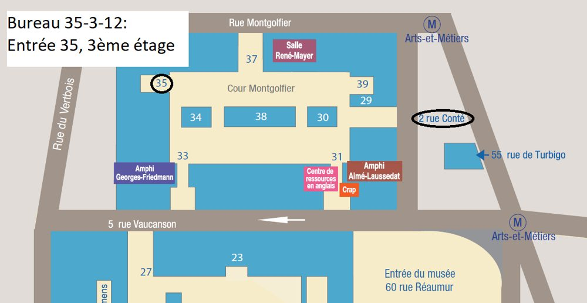

:::: {.columns}
::: {.column width="48%"}
**Email:** [avner@cnam.fr](mailto:avner@cnam.fr)

**Address** 
[Conservatoire National des Arts et Métiers](https://www.cnam.fr) 
EPN 6 — Mathématiques et statistique 
Office 35-3-12 
2, rue Conté 
75003 Paris, France

**Phone:** +33 1 40 27 23 21
:::
::: {.column width="4%"}
:::
::: {.column width="48%" .map-frame}
<iframe src="https://www.google.com/maps/embed?pb=!1m14!1m8!1m3!1d2624.598222957803!2d2.3565048!3d48.8658714!3m2!1i1024!2i768!4f13.1!3m3!1m2!1s0x47e66e0556a8bc7b%3A0xa9426bca6ed95de1!2s2+Rue+Cont%C3%A9%2C+75003+Paris!5e0!3m2!1sfr!2sfr!4v1502194629844" loading="lazy" title="Map: 2 rue Conté, Paris"></iframe>
:::
::::

{.img-fluid .rounded fig-alt="Access map to the office at 2 rue Conté"}

## Elsewhere

[<i class="bi bi-github"></i> GitHub](https://github.com/AB-H){.btn .btn-outline-primary .me-2 .mb-2}
[<i class="bi bi-linkedin"></i> LinkedIn](https://www.linkedin.com/in/avnerb1/){.btn .btn-outline-primary .me-2 .mb-2}
[<i class="bi bi-mortarboard"></i> Google Scholar](https://scholar.google.fr/citations?user=JZ3uW60AAAAJ){.btn .btn-outline-primary .me-2 .mb-2}
[<i class="bi bi-twitter-x"></i> X / Twitter](https://x.com/a_bh){.btn .btn-outline-primary .me-2 .mb-2}
